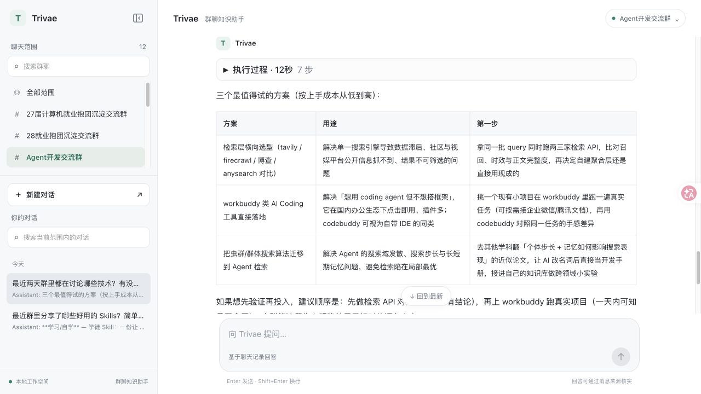
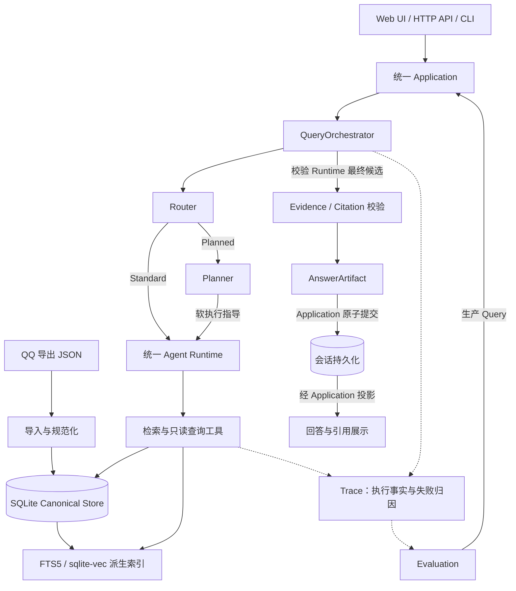

# Trivae

**面向高噪声群聊数据的智能检索与分析系统**

AI-powered Group Conversation Intelligence

Trivae 帮助你从持续积累的群聊历史中定位事实、找回资源、梳理讨论，并用自然语言完成跨消息的信息调查。针对短消息密集、话题切换快、多人交错讨论的特点，系统将数据规范化、多路检索、Agent 工具调用和来源核验接成完整链路，让回答能够回到原始消息复核。

`Python 3.12+` · `FastAPI` · `Vue 3` · `OpenAI Agents SDK` · `SQLite FTS5` · `sqlite-vec`

[快速开始](#快速开始) · [系统架构](#系统架构) · [配置指南](docs/configuration.md) · [Evaluation](docs/evaluation.md)

## 产品预览

在实际群聊数据上，直接用日常问法查找近期技术讨论与资源；也可以继续追问，把长回答整理成用途清单或方案表格。下面均为真实运行的 Web UI 截图。

**查找群里分享的 Skills**

> 最近群里有哪些好用的 Skills？挑三个，每个用一句话介绍用途，附上项目链接，不用写人名。


**从近期讨论中整理技术方案**

> 最近两天群里都在讨论哪些技术？有没有值得试试的方案？

继续追问：挑三个最值得试的方案，用表格列出方案、用途和第一步，不用长篇介绍。



展示画面保留技术主题与公开项目链接，未展开成员身份和原始消息来源；回答保留本次检索的覆盖局限。运行条件与提问过程见[预览说明](docs/product-preview.md)。

## 核心功能

- **群聊历史入库与增量管理**：支持 QQChatExporter 的 V5 / 0.1.0 JSON 形态，将不同群聊、导出批次归入统一数据模型，识别重复与内容冲突，保留来源位置；可通过一次性任务更新检索索引。
- **自然语言调查与多路检索**：Agent 按问题选择全文、语义、近期消息、上下文或只读 SQL 工具，分别处理精确术语、近义表达、讨论脉络和统计问题。
- **复杂问题的规划与工具调用**：Router 判断是否需要预先规划，Planner 为复杂调查提供指导，两条路径共用同一个有回合、工具轮和内容预算的 Runtime。
- **可回溯的证据与引用**：回答关联本轮实际取得的消息或结构化结果，可复核作者、时间与上下文；支持合并转发内部消息来源，显式保留覆盖不全、截断和引用降级诊断。
- **Web UI 与多轮会话**：选择聊天范围、持续追问、查看路由与工具过程、展开 Sources；会话持久化，支持终止生成，也提供 CLI / TUI 入口。
- **生产链路评测与诊断**：通过固定 Snapshot、Case、Variant 和配对 Review 比较方案，沿 Trace 定位路由、检索、工具、证据与提交阶段的问题。

当前数据接入面向 QQ 导出；不表示已支持任意聊天平台。图片、文件等元素保留结构与来源，不提供 OCR 或语音转写。

## 典型场景

以下都是公开的示例问法，需在自己的数据中存在相应讨论：

| 场景 | 可以怎样问 | 系统如何帮助 |
| --- | --- | --- |
| 找回事实与资源 | “群里讨论过 sqlite-vec 吗？找出相关资源和原始说法。” | 用关键词或语义查找消息，再回看相邻上下文与来源。 |
| 梳理一段时间的讨论 | “整理 10 月 1 日至 7 日的部署讨论，按主题列出结论与分歧。” | 按时间浏览、检索并聚合证据；数据过多时报告已覆盖范围与局限。 |
| 跨消息调查 | “大家为何从方案 A 转向方案 B？区分建议、实际尝试和后续反馈。” | 必要时先规划，再多步检索与上下文调查，为结论保留证据和不确定性。 |

## 系统架构



Router 决定是否先调用 Planner，不选择检索策略；Planner 不执行工具。工具由共享 Runtime 调用，Finalizer 由 QueryOrchestrator 执行，客户端和评测使用同一条应用链路。[详细架构](docs/architecture.md)说明各层职责、工具与提交边界。

## 技术设计亮点

### 1. 原始事实与检索投影分离

Canonical Store 保存规范化消息、导出记录位置与来源关系，FTS5 和向量库可以重建。重复导入、冲突和批次错误都有记录；语义索引跟踪模型、切块身份和来源状态，通过变更位置日志更新受影响范围，并在输入一致时复用向量。这样既能追查“这条消息从哪里来”，也能判断“当前索引是否还能用”。

### 2. 让群聊问题选择合适的工具

精确资源名适合 FTS5，近义讨论适合向量召回，计数与排名适合有界只读 SQL。语义索引使用时间感知的 Parent / Child 对话块，命中后回读 Canonical 消息；上下文扩展补充短消息的来龙去脉。多路检索通过 Agent 选择与组合工具实现，不承诺每次固定执行全文与向量融合。

### 3. 规划、执行与预算各有边界

Standard 与 Planned 共用 Runtime，便于在相同条件下单独评价 Planner 的作用。计划是执行指导；工具轮、结果内容预算和绝对回合上限约束调查范围。流式输出、取消和异常保留阶段诊断，Trace 记录实际过程，避免只根据最终文本判断执行成功。

### 4. 来源校验与答案质量分开判断

来源绑定到本轮工具结果与允许访问的数据范围，模型不能自行生成可信作者、时间或来源身份。局部无效引用可按现有合同移除并标记 `degraded`；范围或来源归属等可信边界冲突会阻止交付。程序验证来源有效性与覆盖事实，结论是否被证据充分支持仍需质量评审。

### 5. 评测覆盖完整生产 Query

Evaluation 固定数据 Snapshot、Case 与受控 Variant，复用 Application 查询并读取答案、引用和 Trace；工程检查、质量轴和运行成本分别记录。Reference 标明 `exhaustive / partial / unknown`，机器辅助标注保留 provisional 身份。最近的 Prompt 精简实验因质量退化被拒绝，未作为性能优化发布；这里不把开发样本、测试通过率或 Token 减少写成产品准确率。[评测方法与当前边界](docs/evaluation.md)

## 快速开始

需要 **Python 3.12+、uv、Node.js 22.12+（22 系列）或 24+、pnpm**，以及支持 FTS5 的 Python SQLite。以下命令在仓库根目录执行：

```sh
# 安装完整检索链路与开发工具。
uv sync --extra dev --extra semantic
# 安装并构建 Web UI。
pnpm -C web install --frozen-lockfile
pnpm -C web build
# 仅首次配置时复制；已有 .env 直接编辑。
cp .env.example .env
```

在 `.env` 填写自己的模型配置；默认 API key 示例：

```dotenv
TRIVAE_MODEL_PROVIDER=deepseek
TRIVAE_MODEL_NAME=deepseek-flash
TRIVAE_MODEL_BASE_URL=https://api.deepseek.com
TRIVAE_MODEL_API_KEY=<你的DeepSeek_API_key>
# 快速开始只使用主模型，显式关闭独立 Jev 实验。
TRIVIAE_ROUTER_JEV_ENABLED=false
```

准备自己有权使用的 QQChatExporter JSON，复制到 `data/raw/`：

```sh
mkdir -p data/raw
# 放好已导出完成的 JSON，再导入并更新全文与语义索引。
uv run trivae import-once --raw-dir data/raw \
  --database data/trivae.sqlite3 --update-indexes
# 确认批次与索引工作状态，查看是否存在 pending 或错误。
uv run trivae import-once --database data/trivae.sqlite3 --status
uv run trivae semantic status --database data/trivae.sqlite3
# 启动 Web，默认自动打开浏览器。
uv run trivae web --database data/trivae.sqlite3 --host 127.0.0.1 --port 8710
```

`import-once` 默认要求文件静默至少 60 秒，并间隔 5 秒确认稳定；刚导出的文件被推迟时，待稳定后重跑。首次索引构建会下载并加载本地 `Qwen/Qwen3-Embedding-0.6B`，需预留内存、磁盘与构建时间。普通 `trivae import` 只写 Canonical 数据，不自动建索引；手工导入后的重建方式见[完整上手指南](docs/getting-started.md)。

打开 `http://127.0.0.1:8710`，选择聊天范围后提问；展开执行过程与 Sources 检查依据。修改 `.env` 后重启，Shell 已导出的同名变量优先。终端入口为 `uv run trivae chat --database data/trivae.sqlite3`。

开发验证：

```sh
uv run ruff check src tests
uv run mypy src
uv run pytest
pnpm -C web test
pnpm -C web build
```

## 开发与扩展文档

| 文档 | 内容 |
| --- | --- |
| [本地安装与使用](docs/getting-started.md) | 环境、完整导入与索引流程、Web / CLI、测试 |
| [配置与故障定位](docs/configuration.md) | Provider、ChatGPT OAuth、多账号、Jev、索引升级与续建、验证脚本 |
| [系统架构](docs/architecture.md) | 应用边界、工具、数据与索引、Runtime、引用、Trace |
| [Evaluation](docs/evaluation.md) | Snapshot / Case / Variant、对照评测、质量轴与结论边界 |
| [语义增量索引](docs/semantic-incremental-index.md) | 变更日志、向量复用、版本与更新验证 |
| [QCE 自动导入](docs/qce-auto-import.md) | 文件稳定检查、macOS 调度、索引待办与恢复 |
| [群聊邮件晚报](docs/daily-digest.md) | 分群完整阅读、四类精选、原文依据与晚间邮件交付 |
| [第三方来源与许可](docs/third-party-notices.md) | 来源声明、上游许可及公开前待确认事项 |

## 隐私与许可证

原始聊天、数据库、索引、会话与 Trace 主要保存在本机。模型调用仍会把问题、会话上下文和相关工具结果发送给所配置的 Provider；启用 Jev 时还涉及 OpenRouter 路由请求。**本地存储不等于完全离线。** 请仅导入自己有权处理的数据，分享 Trace 或实验产物前检查聊天摘录与个人信息。

当前 Web 服务面向本机使用，尚不提供公网多用户认证与租户隔离。第三方代码与依赖的来源、许可证及适用说明见[第三方声明](docs/third-party-notices.md)。

## 致谢

感谢 [QQ Chat Exporter](https://github.com/shuakami/qq-chat-exporter) 项目及其贡献者提供 QQ 聊天记录导出工具与结构化 JSON 格式，为 Trivae 的数据导入提供支持。
