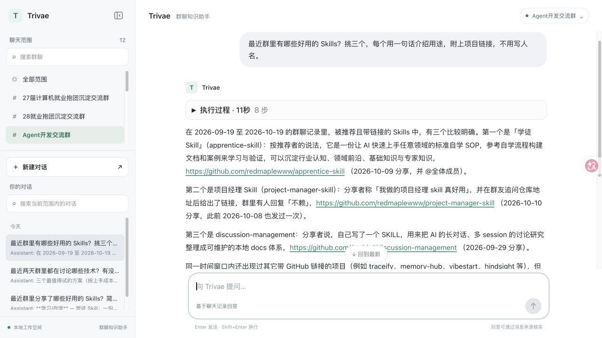
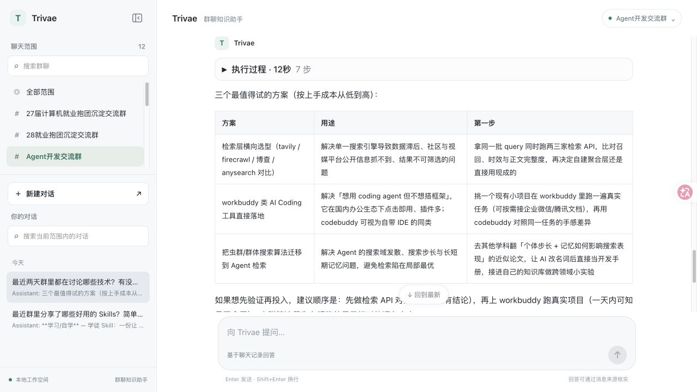
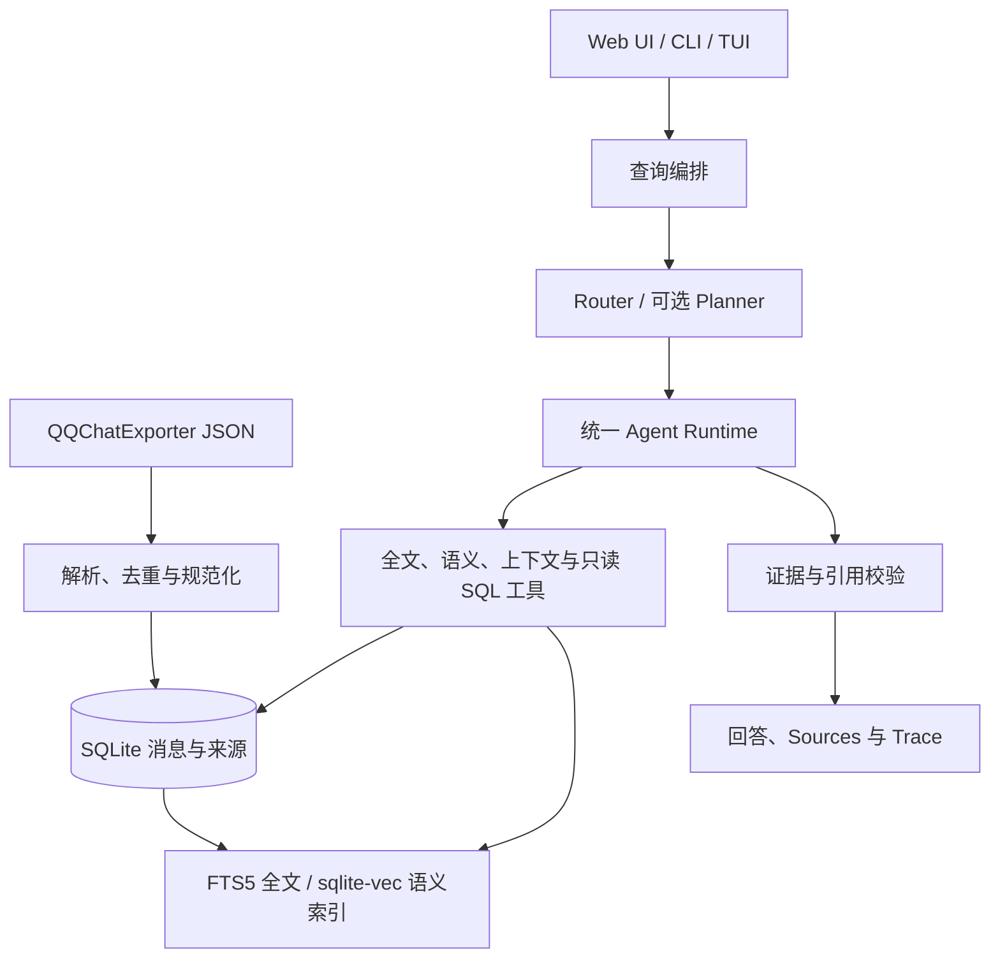

# Trivae

> **让群聊历史变得可搜索、可追溯。**

Trivae 是一个面向 **QQ 群聊历史** 的本地优先智能检索工具。导入聊天记录后，你可以直接用自然语言找回曾经分享的资源、梳理一段时间内的讨论，或追查分散在多条消息中的信息。回答会尽量关联可复核的原始消息，而不只是给出一段没有依据的总结。

**Python 3.12+ · FastAPI · Vue 3 · OpenAI Agents SDK · SQLite FTS5 · sqlite-vec**

[产品预览](#产品预览) · [快速开始](#快速开始) · [工作原理](#工作原理) · [完整文档](#文档导航) · [当前能力与限制](docs/PROJECT_STATUS.md)

## 产品预览

**场景 1：找回群里分享过的工具**

> 最近群里有哪些好用的 Skills？挑三个，每个用一句话介绍用途，附上项目链接，不用写人名。



**场景 2：从多轮讨论中整理可执行的方案**

> 最近两天群里都在讨论哪些技术？有没有值得试试的方案？

继续追问：挑三个最值得试的方案，用表格列出方案、用途和第一步。



以上为真实运行的 Web UI 截图，展示内容经过选择，未展开聊天成员身份及原始消息来源。具体输入和运行条件见[预览说明](docs/product-preview.md)。

## 能做什么

- **找回历史信息**：结合全文与语义检索，定位术语、项目链接、资源分享及不同表述的相关消息。
- **理解讨论上下文**：根据问题查看相邻消息、近期讨论与跨消息线索，而不是只匹配孤立的一句话。
- **带来源地回答**：关联本轮真实取得的消息与结构化结果；可展开 Sources 复核，遇到覆盖不足或引用异常时保留诊断。
- **持续追问和切换范围**：在 Web UI 中选择聊天范围、开展多轮会话、查看工具执行过程，也可以使用 CLI / TUI。
- **导入和持续更新**：支持 QQChatExporter 的 V5 / 0.1.0 JSON 格式，识别重复导入并更新全文、语义索引。
- **评估真实查询链路**：使用固定数据快照、测试用例、运行 Trace 与配对 Review 对照不同方案，不另造一套仅用于跑分的 Agent。

例如，你可以问：“群里提到过 sqlite-vec 吗？有哪些相关资源？”、“上周的部署讨论最终有哪些结论和分歧？”或“大家为什么从方案 A 转向方案 B？”。查询效果取决于导入数据的内容与覆盖范围。

## 快速开始

### 1. 安装

需要 **Python 3.12+、uv、Node.js 22.12+（22 系列）或 24+、pnpm**；Python SQLite 需支持 FTS5。

```bash
git clone https://github.com/kaguranananana/Trivae.git
cd Trivae

uv sync --extra dev --extra semantic
pnpm -C web install --frozen-lockfile
pnpm -C web build
cp .env.example .env
```

如果已经有 `.env`，请直接编辑，不要覆盖已有配置。

### 2. 配置模型

仓库默认使用 `gpt-plus`（ChatGPT OAuth），可先执行 `uv run trivae auth login --provider chatgpt` 完成授权。

也可以使用 API Key。以下是在 `.env` 中切换到已登记的 DeepSeek profile 的示例：

```dotenv
TRIVAE_MODEL_ID=deepseek-flash
DEEPSEEK_API_KEY=<你的 DeepSeek API Key>
TRIVIAE_ROUTER_JEV_ENABLED=false
```

这里的 `TRIVIAE_ROUTER_JEV_ENABLED` 是现有配置的历史拼写，用于关闭可选的独立 Router 实验；主模型仍正常工作。其他模型、配置优先级及排障说明见[配置指南](docs/configuration.md)。

### 3. 导入聊天记录

使用自己有权处理的 **QQChatExporter JSON**，将已完成导出的文件放入 `data/raw/`：

```bash
mkdir -p data/raw
uv run trivae import-once --raw-dir data/raw \
  --database data/trivae.sqlite3 --update-indexes

uv run trivae import-once --database data/trivae.sqlite3 --status
uv run trivae semantic status --database data/trivae.sqlite3
```

`import-once` 会检查文件是否稳定（默认至少静默 60 秒，再间隔 5 秒确认）；刚导出的文件可能被推迟，待稳定后重跑。首次构建语义索引会下载并加载 `Qwen/Qwen3-Embedding-0.6B`，请预留磁盘、内存和处理时间。状态检查有助于发现索引仍在等待或构建失败。

### 4. 启动并提问

```bash
uv run trivae web --database data/trivae.sqlite3 --host 127.0.0.1 --port 8710
```

打开 **http://127.0.0.1:8710**，选择聊天范围后输入问题；在回答中展开 Sources 检查原始依据。终端也可以运行 `uv run trivae chat --database data/trivae.sqlite3`。

更多环境选项、手动重建索引与故障排查见[完整上手指南](docs/getting-started.md)。

## 工作原理

Trivae 把原始聊天数据与可重建的检索索引分开存储。提问时，Agent 依照问题选取检索或查询工具，再将回答与实际取得的证据关联。



Router / Planner 负责决策和指导，实际工具执行共用同一个 Runtime。对于不确定的结论，系统保留检索范围、截断和引用降级信息；**有来源不等于语义结论一定正确**。详细边界见[架构设计](docs/architecture.md)。

## 评测与验证

Trivae 的 Evaluation 复用正常查询入口，通过 **Snapshot / Case / Variant / Review** 对比方案，并使用 Trace 观察路由、检索、工具调用和引用阶段。评测强调可复现与定位失败原因，不将少量测试结果描述为通用准确率。

```bash
uv run ruff check src tests
uv run mypy src
uv run pytest
pnpm -C web test
pnpm -C web build
```

评测流程与结论边界见[Evaluation](docs/evaluation.md)；最近一次有记录的验证和仍待覆盖的场景见[项目状态](docs/PROJECT_STATUS.md)。

## 文档导航

| 文档 | 适合什么时候阅读 |
| --- | --- |
| [安装与使用](docs/getting-started.md) | 第一次运行、导入数据、重建索引 |
| [配置与排障](docs/configuration.md) | 调整模型、OAuth、索引与真实链路 |
| [系统架构](docs/architecture.md) | 理解 Agent、工具、存储和引用流程 |
| [Evaluation](docs/evaluation.md) | 了解测试用例、Trace 与对照评测 |
| [当前项目状态](docs/PROJECT_STATUS.md) | 确认已验证能力和限制 |
| [增量索引](docs/semantic-incremental-index.md) | 理解数据更新和向量复用 |
| [自动导入](docs/qce-auto-import.md) | 配置本机定时同步 |
| [开发记录](docs/DEVLOG.md) | 查找历史实验与设计演进 |

## 当前范围与隐私

- **数据接入**：目前面向 QQChatExporter JSON，不是通用聊天平台导入器；媒体元素可保留来源结构，但**不提供 OCR 或语音转写**。
- **本地优先，不等于离线**：原始聊天、索引与会话主要保存在本机；模型调用仍可能把问题、会话上下文和相关检索结果发送至配置的 Provider，启用 Jev 时还会涉及 OpenRouter。
- **部署边界**：当前 Web 服务面向本机使用，尚无公网多用户认证与租户隔离；请勿直接作为公开服务部署。
- **授权说明**：仓库当前未提供根目录 `LICENSE` 文件。源码公开可见不代表自动授予复用或再分发许可；第三方来源见[相关声明](docs/third-party-notices.md)。

## 致谢

感谢 [QQ Chat Exporter](https://github.com/shuakami/qq-chat-exporter) 项目提供聊天记录导出工具及结构化 JSON 格式。
