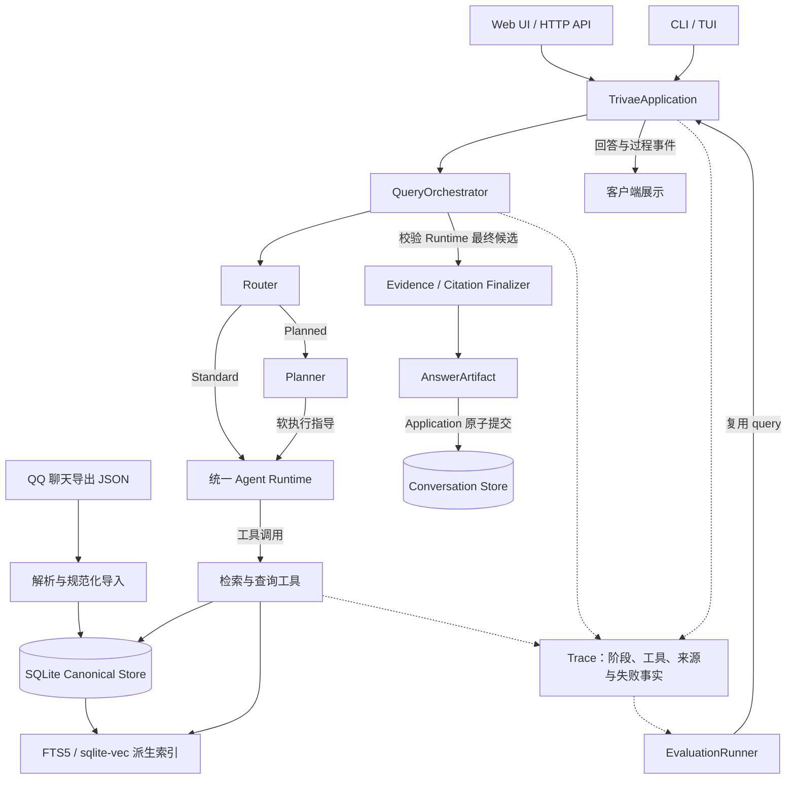

# 系统架构

Trivae 将群聊历史的导入、检索、Agent 调查和证据回溯接成同一条处理链路。SQLite Canonical Store 保存规范化消息与来源；索引提供查找能力；Agent 使用有界工具获取事实；Finalizer 将答案与可验证来源绑定后，由 Application 提交会话。

本文描述当前实现。运行配置见 [配置指南](configuration.md)，质量验证与实验边界见 [Evaluation](evaluation.md)。

## 从数据到回答

图中的实线表示调用或数据流，虚线表示观测与评测读取。Router 和 Planner 都不直接执行检索；两条执行路径共用 Runtime。Evaluation 从 Application 发起生产查询，不另建一套用于跑分的 Agent。

## 统一应用边界

[application.py](../src/trivae/bootstrap/application.py) 是组合与应用入口，负责实例装配、会话读取、可信数据范围、查询生命周期、Trace 和结果提交。Web、CLI 和 Evaluation 通过这层调用业务能力。

查询沿以下顺序运行：

1. Application 读取持久化会话历史，构造本轮 QueryRequest 和 ExecutionScope。
2. QueryOrchestrator 调用 Router；需要规划时额外调用一次 Planner。
3. 同一个 Runtime 消费上下文和可选计划，通过注册工具调查问题。
4. Finalizer 解析最终候选，验证来源与引用，生成 AnswerArtifact。
5. Application 将用户消息、助手 Artifact 和过程投影一并提交到 Conversation Store。

会话历史由 Trivae 持有。事务失败会回滚用户与助手消息；Runtime 失败或取消不会提交一个“已完成”的助手答案。相关边界见 [conversation.py 测试](../tests/test_conversation.py) 和 [查询执行测试](../tests/test_query_execution_core.py)。

## 数据治理与索引生命周期

导入器将来源差异收敛到统一数据模型：Source、ChatSession、UserIdentity、Membership、Message 和 ImportBatch。共享导入管线按文件事务写入；记录级问题保留错误位置和统计，重复消息保留来源出现记录，内容冲突单独记录。

Canonical Store 是事实来源。FTS5 和 sqlite-vec 是可重建的派生索引，不能替代原始消息。语义检索先取向量候选，再从 Canonical Store 恢复消息范围；最终引用使用真实消息，而非仅引用向量块摘要。

语义索引记录模型、维度、切块配置及 Canonical 数据状态。缺失、构建中、失败或过期状态会显式报告；语义检索不会静默切换成词法检索。增量构建使用消息位置日志、受影响范围重切、精确输入复用和事务发布，细节见 [语义增量索引](semantic-incremental-index.md)。

当前导入接入面向已支持的 QQ 导出格式；不同导出来源进入统一模型，不代表已经支持任意聊天平台。定时增量导入见 [QCE 自动导入](qce-auto-import.md)。

## 让检索方式服从问题

群聊里，资源名、短句、概念讨论和统计问题需要不同的查询方式。Runtime 根据问题选择或组合下列工具：

| 工具 | 适合的问题 | 实现边界 |
| --- | --- | --- |
| `lexical_search` | 精确名称、链接、术语和原话 | FTS5 词法检索，命中可携带有界上下文 |
| `semantic_search` | 用词不同但含义相近的讨论 | 基于对话块向量召回，再恢复 Canonical 消息 |
| `get_recent_messages` | 指定时间段浏览、近期主题发现 | 有界分页，显式返回时间锚点与覆盖情况 |
| `get_message_context` | 回看回复、后续反馈、讨论来龙去脉 | 围绕消息锚点读取有界上下文 |
| `find_members` | 人物身份与同名消歧 | 从规范化成员记录查找身份 |
| `get_schema` | 了解可查询的结构化字段 | 返回公开的 SQLite Schema |
| `execute_sql` | 计数、排名、聚合和结构化筛选 | 范围内的有界只读 SQL |

注册表还保留历史名称 `search_messages`。它不是额外的检索策略，公开能力以表中七个工具为主。

这里的多路检索是 Agent 在调查中选择、组合工具；当前不应理解成每次查询都会执行固定的词法与向量融合、统一重排。SQL 的访问范围在模型生成语句之外执行约束，结果行数也由宿主限制，模型无需通过自行添加 `LIMIT` 才获得边界。相关实现见 [capabilities](../src/trivae/capabilities) 与 [SQLite 读取测试](../tests/test_sqlite_read.py)。

## Router、Planner 与统一 Runtime

Router 只决定是否值得预先规划，输出 `standard_execution` 或 `planned_execution`。它先做规则判断，再按配置对模糊问题调用决策 Provider；可选的 Jev 与 shadow 模式属于独立配置与实验入口。Router 不选择检索算法、SQL 或具体工具参数。

Planner 在 Planned 路径进入 Runtime 前运行一次，生成有界的结构化调查指导。计划会过滤不可用工具并校验字段，但不会成为机械执行的工作流，也没有独立的循环执行器或自动重规划。规划不可用时，现有合同允许同一 Runtime 继续，并保留明确诊断。

Runtime 基于 OpenAI Agents SDK 承载单 Agent 工具循环。Trivae 持有上下文、工具适配、结果预算、取消、事件和最终合成边界。工具轮预算与 SDK 的绝对回合上限分别约束调查和异常失控：到达正常工具轮预算后进入最终合成，绝对上限仍属于失败边界。流式客户端看到的是项目事件投影，而不是 SDK 内部对象。

预算同时约束单次工具结果和本轮累计证据内容。截断与省略会作为事实记录；共享预算接近耗尽时，Runtime 返回显式的预算停止结果并阻止超预算投影。模型可能因此看不到更多命中，有界输出也不能保证全量检索或充分回答。

实现与回归入口：[orchestrator.py](../src/trivae/query/orchestrator.py)、[planner.py](../src/trivae/query/planner.py)、[openai_adapter.py](../src/trivae/query/runtime/openai_adapter.py)、[Runtime 测试](../tests/test_agent_runtime.py)。

## 证据、引用与提交

AnswerArtifact 将正文块、结论对应的 Evidence、Citation Binding 和局限放在同一份结构化结果中。消息来源包含可复核的会话、作者、时间和摘录；SQL 等结果使用结构化来源及查询范围快照。

来源必须能解析到本轮实际获取的工具结果，并满足 ExecutionScope。显示元数据由可信记录补齐，不能由模型随意声明；旧轮次证据不能直接冒充本轮新来源。语义来源还区分 `supports`、`contradicts` 和 `context`，帮助表达证据与结论的关系。

当前 Finalizer 先进行严格验证。局部字段或引用错误可按已有合同确定性移除、规范化，并输出 `degraded` 状态与诊断；有效正文可能被保留。来源归属、访问范围、消息身份、可信时间或覆盖事实冲突仍会阻止交付。这意味着**有回答不等于所有结论都通过证据验证**，也不意味着程序已经证明自然语言推断必然正确。

检索覆盖与结论充分性同样分开：某条结论有充分证据，不代表已完整浏览全库；部分检索无命中，也不能直接变成“从未有人讨论”。当前零结果答案需要完整且为空的可信检索事实。相关合同见 [evidence.py](../src/trivae/query/evidence.py) 与 [Evidence 测试](../tests/test_evidence.py)。

## Trace 与质量诊断

Trace 使用 Trivae 自有的规范化事件，记录 Router、Planner、Runtime、工具、检索、Finalizer 和会话提交。事件保留顺序、操作因果关系、错误归属及可用的耗时与 Usage；读取投影从事件历史推导终态，而非只相信一个成功标志。

Normal 和 Debug 使用不同采集策略；Debug 可以包含模型可见输入与证据细节，导出前应按实际数据检查。SDK 自带外部 tracing 在当前 Runtime 中显式关闭，但模型调用本身仍会把必要的问题、上下文和工具结果发送给所配置的 Provider。数据本地存储不等于离线推理。

Trace 的完整性、请求耗时、Token 与工具次数用于定位工程问题；回答质量由独立 Review 判断。测试和具体方法见 [Evaluation](evaluation.md)。

## 已实现与待验证的边界

当前源码包含 Web UI、CLI/TUI、多轮会话、真实 Provider 工具调用、数据导入、三类查询能力、证据检查、Trace 和生产链路评测。仓库测试验证了这些组件的确定性合同，已有真实运行也覆盖导入、索引和部分查询场景。

上述事实不构成全场景答案准确率、稳定性能或生产部署承诺。Planner 是否有收益、Router 是否能识别有收益的问题、检索是否覆盖目标语料，以及提示词改动能否发布，都需要在固定数据与配置下分别评测。长期质量阈值、广泛人工标注与跨环境性能仍需更多证据。

## 研究分支的语义保留顺序（2026-10-30）

语义候选排序和canonical展示排序分别处理。ContextExpander容量不足时先保留真实字面证据，再沿用候选检索排名；SemanticRetrieval以primary_message_ids传递核心优先序，Host在工具预算删除hit时继续该顺序。返回列表仍按原canonical时间展示，引用身份、Scope、Top-K、容量和预算不变。该修复解决已命中消息在两层裁剪中丢失的问题，不证明自然语言结论必然受支持；具体对照、暴露情况与回归边界见[研究报告](../research/agent-quality-20261029/REPORT.md)。当前为本地研究分支实现，未部署主线服务。
